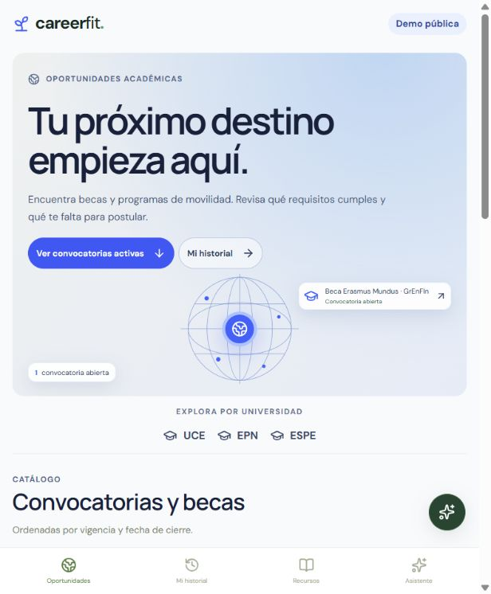
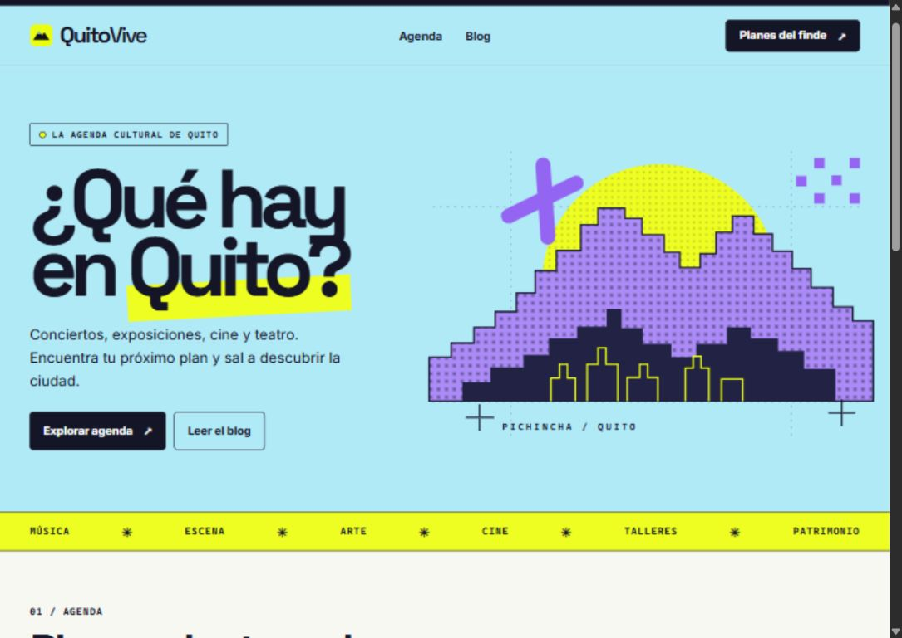

# Hola, soy Stiven Díaz

Estudio Ingeniería en Software en la ESPE. Desarrollo aplicaciones web full stack con Angular y NestJS, desde las pantallas de usuario hasta las APIs REST y la persistencia en PostgreSQL. También desarrollo aplicaciones multiplataforma con Flutter y Dart y automatizo despliegues con GitHub Actions.

## Proyectos destacados

### Mija Tienda · Gestión comercial para tiendas

Aplicación web en producción que utilizan tiendas para gestionar ventas de mostrador, inventario, caja y cartera. Trabajé en el backend (`BackendHero`, API de Tienda) y el frontend (`frontend_Tienda`, en Angular) de la misma aplicación.

- Implementé en la API los flujos de ventas de contado y a crédito, cobros, caja y devoluciones. Añadí idempotencia para evitar duplicados al reintentar operaciones y desarrollé reportes en PDF y Excel.
- Desarrollé e integré con la API las pantallas de catálogo, inventario por lotes, mostrador y portal del comprador. El mostrador admite escaneo de códigos de barras y ventas por unidad y por peso.

**[Abrir aplicación en producción](https://mija-tienda-web-492501.web.app/acceso/login)** · [Repositorio del backend](https://github.com/DavidAToapanta/BackendHero)

**Tecnologías** · `Angular` · `TypeScript` · `NestJS` · `Prisma` · `PostgreSQL` · `Firebase Hosting`

### EVENTUAL · Gestión de eventos para clubes

Proyecto académico en equipo. La demo permite consultar el calendario del club, confirmar asistencia con acompañantes y proponer actividades. Puedes cambiar al perfil simulado de presidente para probar la aprobación de una propuesta.

**[Probar demo web](https://vonchox.github.io/Eventual/)** · [Ver código](https://github.com/Vonchox/Eventual) · [Compilaciones de Android y Windows](https://github.com/Vonchox/Eventual/actions/workflows/native.yml)

**Tecnologías:** `Flutter` · `Dart` · `GitHub Actions` · `GitHub Pages`

Un mismo cliente para web, Android y Windows. La demo usa datos ficticios y cada instalación guarda sus cambios localmente.

### Career-Fit · Becas y movilidad académica

Aplicación web para explorar becas y programas de movilidad, con guías y fuentes oficiales para estudiantes de la UCE, la EPN y la ESPE. Puedes consultar convocatorias, revisar los criterios de cada oportunidad y ver qué requisitos cumples o cuáles te faltan.

**[Probar demo web](https://vonchox.github.io/career-fit/)** · [Ver código](https://github.com/Vonchox/career-fit) · [Flujo de publicación](https://github.com/Vonchox/career-fit/actions/workflows/pages.yml)

**Tecnologías:** `React` · `Vite` · `Node.js` · `Express` · `Prisma` · `GitHub Actions` · `GitHub Pages`

La demo funciona sin cuenta en celular y escritorio. Incluye un asistente de orientación y guarda el historial de evaluaciones en el navegador.

### QuitoVive · Agenda cultural de Quito

Guía web para descubrir conciertos, exposiciones, cine, teatro y talleres en Quito. La agenda permite buscar por artista, evento o lugar y filtrar por fecha, categoría y entrada gratuita.

**[Probar demo web](https://vonchox.github.io/QuitoVive/)** · [Ver código](https://github.com/Vonchox/QuitoVive) · [Flujo de publicación](https://github.com/Vonchox/QuitoVive/actions/workflows/pages.yml)

**Tecnologías:** `Astro` · `TypeScript` · `CSS` · `GitHub Actions` · `GitHub Pages`

Cada ficha enlaza a la fuente consultada e indica cuándo se verificó. El blog reúne guías de fin de semana y notas sobre artistas y espacios culturales.

## Certificaciones

- **Cisco** · [English for IT: Needs and Responsibilities](https://www.credly.com/badges/7434ed4d-3bf7-40eb-a051-a409c826c238) · [Digital Safety and Security Awareness](https://www.credly.com/badges/2aa0b5ff-0e1e-4beb-b174-af8e71282440) · [Introduction to Modern AI](https://www.credly.com/badges/8117620f-95db-4119-9366-0bcc4e699fcf) · [Digital Awareness](https://www.credly.com/badges/e57b1feb-ec27-470e-9644-a3317ced77bc)
- **IBM SkillsBuild** · [Agile Explorer](https://www.credly.com/badges/b646f9de-747f-4c6f-a240-25e185e3649b)

## Contacto

[LinkedIn](https://linkedin.com/in/stivenddddiaz) · [Correo](mailto:stivenhernan1258@gmail.com)
