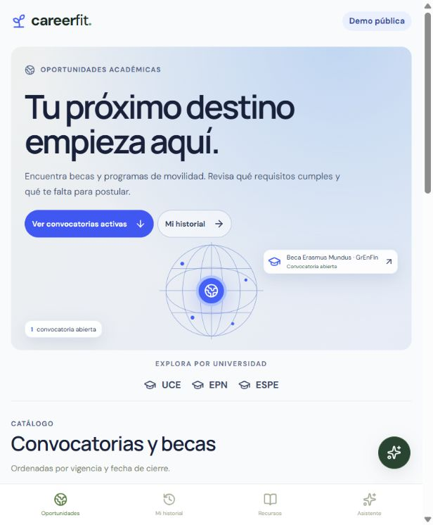

# Hola, soy Stiven Díaz

Estudio Ingeniería en Software en la ESPE. Desarrollo aplicaciones con Flutter y Dart y me interesa llevar una misma aplicación a la web, al celular y al escritorio. También exploro el desarrollo fullstack y la automatización de despliegues.

## Proyectos destacados

### EVENTUAL · Gestión de eventos para clubes

Proyecto académico en equipo. La demo permite consultar el calendario del club, confirmar asistencia con acompañantes y proponer actividades. Puedes cambiar al perfil simulado de presidente para probar la aprobación de una propuesta.

**[Probar demo web](https://vonchox.github.io/Eventual/)** · [Ver código](https://github.com/Vonchox/Eventual) · [Compilaciones de Android y Windows](https://github.com/Vonchox/Eventual/actions/workflows/native.yml)

**Tecnologías:** `Flutter` · `Dart` · `GitHub Actions` · `GitHub Pages`

Un mismo cliente para web, Android y Windows. La demo usa datos ficticios y cada instalación guarda sus cambios localmente.

### Career-Fit · Becas y movilidad académica

Aplicación web para explorar becas y programas de movilidad, con guías y fuentes oficiales para estudiantes de la UCE, la EPN y la ESPE. Puedes consultar convocatorias, revisar los criterios de cada oportunidad y ver qué requisitos cumples o cuáles te faltan.

**[Probar demo web](https://vonchox.github.io/career-fit/)** · [Ver código](https://github.com/Vonchox/career-fit) · [Flujo de publicación](https://github.com/Vonchox/career-fit/actions/workflows/pages.yml)

**Tecnologías:** `React` · `Vite` · `Node.js` · `Express` · `Prisma` · `GitHub Actions` · `GitHub Pages`

La demo funciona sin cuenta en celular y escritorio. Incluye un asistente de orientación y guarda el historial de evaluaciones en el navegador.

## Contacto

[LinkedIn](https://linkedin.com/in/stivenddddiaz) · [Correo](mailto:stivenhernan1258@gmail.com)
